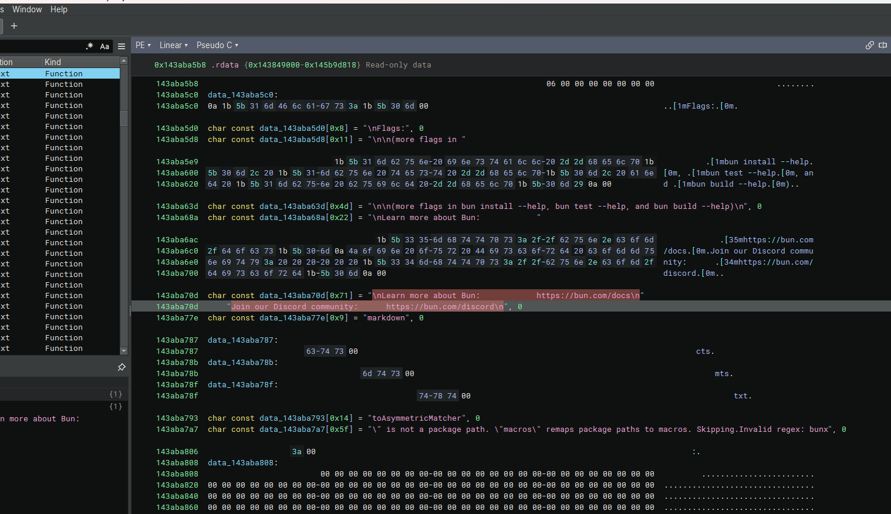
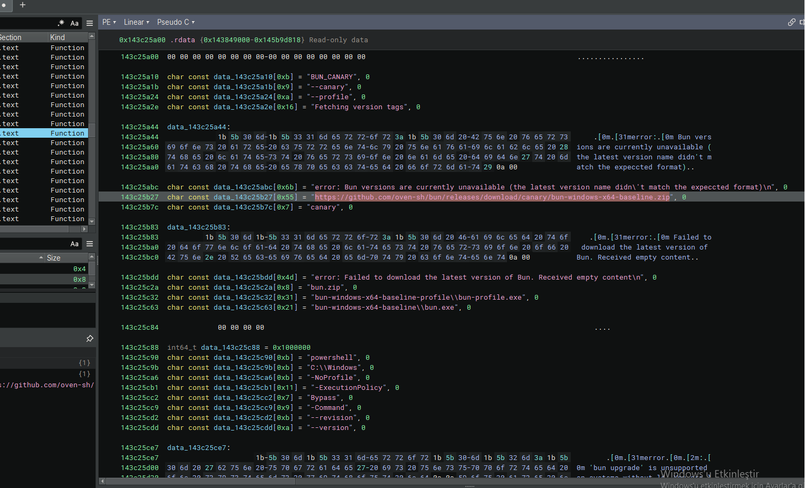
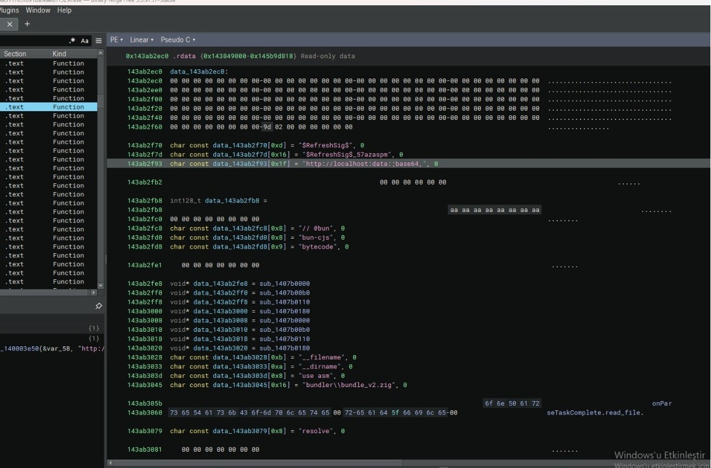
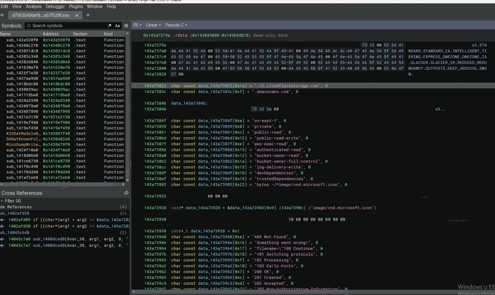
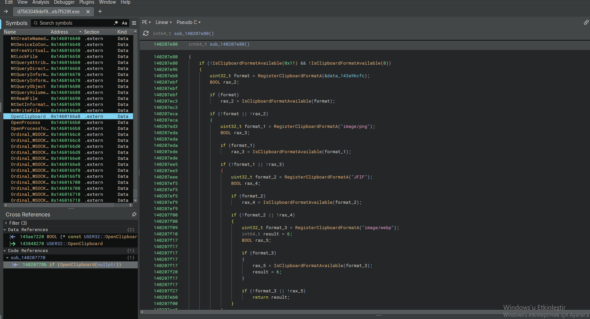

## 1. Binary Ninja – Open-Source Imitation & String Obfuscation

The NWH Stealer sample loaded in Binary Ninja reveals a surprising technique: it heavily utilizes strings, CLI arguments, and documentation links from Bun (a legitimate JavaScript runtime). By embedding legitimate text like "Learn more about Bun" and Discord invite links, the malware attempts to masquerade as a benign developer tool or framework, while hiding its true malicious intent in the .rdata section.

### Key Observations:

**bun install --help** / **bun test --help** / **bun build --help** – mimics Bun CLI usage
**https://bun.com/docs** / Join our Discord community: **https://bun.com/discord** – embeds official Bun documentation and community links.
markdown / ToAsymmetricMatcher / Invalid regex: bunx – standard Bun error messages and test matchers.
**Obfuscation**: The strings are interspersed with control characters and ANSI escape codes (e.g., [1m, [0m, \n), making static signature scanning difficult.

### Why This Matters:

**Living off the Land (LotL)**: By copying legitimate strings from the Bun runtime, NWH Stealer blends into developer environments. AV solutions and sandboxes are less likely to flag traffic or API calls originating from an execution environment that looks like "Bun".
**String Obfuscation**: Embedding legitimate strings alongside encrypted or obfuscated payload arrays (data_143aba5b8) makes it much harder to isolate the actual malicious indicators.
**Evasion by Design**: The malware authors specifically chose a popular, modern developer tool (Bun) to disguise the stealer's presence in developer or CI/CD environments.

### Visual Reference:

## 2. Binary Ninja – Payload Download & PowerShell Execution

Continuing the analysis in Binary Ninja, the NWH Stealer reveals its dropper and execution chain. The malware does not just pretend to be Bun; it actively reaches out to the official GitHub repository to download the legitimate bun-windows-x64 archive. However, the subsequent strings expose a malicious PowerShell execution routine designed to run the downloaded payload with evasion flags.

### Key Observations:

**Download URL**: https://github.com/oven-sh/bun/releases/download/canary/bun-windows-x64-baseline.zip – downloads the legitimate Bun runtime to establish a cover story or use as a LOLBin.
**Extracted Payload Paths**: bun-windows-x64-baseline\bun-profile.exe bun-windows-x64-baseline\bun.exe
**PowerShell Execution Chain**: 

powershell

-NoProfile (skips loading the user's PowerShell profile)

-ExecutionPolicy Bypass (bypasses script execution restrictions)

-Command (executes the inline command)

--revision / --version (likely used as arguments to the downloaded payload to make it look like a legitimate version check).

### Why This Matters:

**Supply Chain** / **GitHub Abuse**: By downloading from the official github.com/oven-sh/bun repository, the stealer bypasses network filters that block unknown domains.
**LOLBin Execution**: The downloaded bun.exe or bun-profile.exe is used as a legitimate wrapper to execute malicious commands, blending in with normal developer activity.
**PowerShell Evasion**: The flags -NoProfile and -ExecutionPolicy Bypass are classic techniques to ensure the malicious script runs without being blocked by system policies or user configurations.

### Visual Reference:

## 3. Binary Ninja – Base64 Localhost Payload & In-Memory Execution

A critical section of the NWH Stealer's reveals its in-memory payload delivery mechanism. The presence of the http://localhost:data:;base64, string, combined with V8 engine bytecode (--filename, use asm, bytecode), indicates the stealer uses a fileless execution technique. It builds a Base64-encoded data URI and executes it locally, likely to inject malicious JavaScript/WebAssembly directly into a running environment without writing a file to disk.

### Key Observations:

**Data URI Scheme**: **http://localhost:data:;base64**, – constructs an inline Base64 payload pointing to localhost. This is a known technique to bypass network filters and execute code from memory.
**V8 / Node.js** / ***Bun Internals**: // @bun / bun-cjs / bytecode – specific flags used by the Bun runtime to execute JavaScript or pre-compiled V8 bytecode.
**--filename** / **--dirname** / use asm – V8 engine flags used to load and optimize raw WebAssembly or JavaScript modules in memory.
**Compiled Payload Artifacts**: **bundler\bundle_v2.zig** – references the Bun bundler, further solidifying the cover story.
**SEHRefreshSigS** / **SEHRefreshSigS_57azaspm** – likely obfuscated function names or encryption keys for the Base64 payload.
**Fileless Injection Indicators**: **seTaskComplete.read_file** / resolve – asynchronous file/stream reading and module resolution routines.

### Why This Matters:

**Fileless Execution** (Evasion): By using a data:;base64 URI, the stealer executes its payload entirely in memory. This leaves no executable file on the disk for AV to scan, bypassing traditional signature-based detection.
**Localhost Abuse**: The localhost prefix tricks firewalls and EDRs into thinking the traffic is internal (and therefore safe), while the actual malicious content is decoded and executed.
**V8 Bytecode Abuse**: Loading bytecode via --filename and use asm means the stealer can execute raw, compiled JavaScript/WebAssembly, making reverse engineering significantly harder than plain text scripts.
**Bun Runtime Abuse**: The // @bun and bun-cjs strings confirm the stealer is using the downloaded Bun runtime as a legitimate execution engine for its malicious in-memory code.

Living off the Cloud: By using legitimate cloud services (AWS, Cloudflare R2), the stealer blends its exfiltration traffic with normal enterprise cloud usage, making detection extremely difficul

### Visual Reference:

## 4. Binary Ninja – Cloud Infrastructure Targeting & Exfiltration

The section further exposes NWH Stealer's targeting of cloud infrastructure and developer assets. Instead of relying on a single hardcoded C2 IP, the malware includes strings for major cloud providers (Cloudflare R2, AWS), developer toolchains (Visual Studio, Node.js), and HTTP status codes. This indicates a dynamic C2 resolution or an extensive credential harvesting list aimed at cloud environments.

### Key Observations:

**Cloud & C2 Infrastructure**: **r2.cloudflarestorage.com** – Cloudflare R2 storage (used for data exfiltration or payload hosting).
**amazonaws.com** – AWS infrastructure (likely targeted for credential theft or used as a C2 relay).
**us-east-1** – AWS region identifier (used for S3 bucket targeting).
**Developer / IDE Targets** (Credential Harvesting): **NDARD.STANDARD.TA.INTELLIGENT.I** / **ERING.EXPRESS..ONEZONE.ONEZONE.IA** – Clearly obfuscated/fragmented strings referencing Visual Studio / IntelliJ.
**GLACIER.GLACIER.IR.REDUCED.REDU** – AWS Glacier (backup/archive service) references.
**Cloud Permission Flags** (For Lateral Movement / PrivEsc): **private** / **public-read** / **private-read-write** / **aws-exec-read** **bucket-owner-read **/ **bucket-owner-full-control**

 ### Why This Matters:

**Cloud Credential Theft**: The presence of AWS/GCP/Cloudflare strings and S3 ACL permissions means the stealer is specifically hunting for cloud access keys, IAM tokens, and bucket configurations on the victim's machine.
**Data Exfiltration**: **r2.cloudflarestorage.com** and **amazonaws.com** are commonly abused by stealers to upload stolen data because cloud storage domains are rarely blocked by firewalls.
**Developer Targeting**: References to devDependencies, Visual Studio, and IntelliJ indicate the stealer targets software developers and CI/CD pipelines, where cloud credentials are highly valuable.
**Dynamic C2**: The variety of status codes (200 OK, 404 Not Found, etc.) suggests the malware parses HTTP responses to adapt its C2 communication dynamically
**Living off the Cloud**: By using legitimate cloud services (AWS, Cloudflare R2), the stealer blends its exfiltration traffic with normal enterprise cloud usage, making detection extremely difficul

### Visual Reference:

## 5. Binary Ninja – Clipboard Hijacking & Information Stealing Payload

The final analysis of the NWH Stealer reveals its true purpose. Below the Bun imitation, the actual payload contains a dedicated function (sub_140207e80) designed to intercept and analyze clipboard data. By monitoring for specific image formats (image/png, image/webp, JFIF), the stealer targets cryptocurrency wallet addresses, passwords, and sensitive screenshots. The cross-references and imported API list confirm classic credential-stealing behavior.

### Key Observations:

**Clipboard Monitoring Routine**: **IsClipboardFormatAvailable** / **RegisterClipboardFormatA** / **OpenClipboard** – constantly checks if sensitive data is copied.
**"image/png"**, **"image/webp"**, "JFIF" – targeted clipboard formats; often used to steal crypto wallet QR codes or screenshots containing private keys.
**Imported Native APIs** (Cross-References & Symbols): **NtQueryInformationProcess** / **NtSetInformationProcess**– advanced process manipulation (likely for anti-debugging or injection).
**NtCreateNamedPipeFile** / **NtDeviceIoControlFile** – low-level IPC and driver communication (stealthy data transfer).
**NtFreeVirtualMemory** / **NtQueryVirtualMemory** – manual memory management (evading memory scanners).
**Ordinal_WSOCK32** – network communication via Winsock (likely for C2 or data exfiltration).
**MiniDumpWriteDump** – !!! This is a massive red flag. It indicates the stealer is dumping process memory to extract passwords (e.g., from LSASS).

### Why This Matters:

**Clipboard Hijacking** (Crypto Theft): Constantly checking for image/png or webp means if a user copies a crypto wallet address or a 2FA QR code, the malware instantly swaps or steals it.
**Credential Dumping**: The presence of MiniDumpWriteDump confirms the stealer can dump the memory of critical processes (like lsass.exe) to extract Windows login passwords.
**Low-Level Evasion**: Using native Nt* APIs instead of standard Win32 APIs (like ReadProcessMemory) allows the malware to bypass user-mode hooks placed by EDR solutions.
**Data Exfiltration**: WSOCK32 and NtCreateNamedPipeFile provide multiple channels (direct network or local pipes) to send the stolen clipboard and memory data back to the attacker.
**The Real Payload**: This section proves that while the outer layer pretends to be a legitimate "Bun" developer tool, the core function is a fully capable info-stealer and clipboard hijacker.

### Visual Reference:

### Conclusion:

The analysis of the NWH Stealer reveals a highly deceptive and dangerous information stealer that utilizes a unique "Trojanized Developer Tool" approach. By masquerading as the legitimate "Bun" JavaScript runtime, the malware bypasses user suspicion and basic security filters, only to unpack a fileless payload that hijacks the clipboard, dumps process memory, and targets cloud infrastructure.

### Key Observations:

**Social Engineering & Imitation**: The stealer heavily abuses strings, CLI arguments, and documentation from the legitimate Bun runtime to appear benign.
**Fileless Execution & PowerShell**: It downloads the real Bun executable from GitHub and uses PowerShell (-ExecutionPolicy Bypass) to execute a Base64-encoded (data:;base64) payload entirely in memory.
**Cloud & Developer Targeting**: Hardcoded strings for AWS (amazonaws.com), Cloudflare R2, and S3 bucket permissions indicate the malware hunts for cloud credentials and developer secrets (e.g., .env files, Visual Studio tokens).
**Advanced Credential Dumping**: The presence of MiniDumpWriteDump and low-level Nt* native APIs confirms it can dump process memory (e.g., LSASS) to steal Windows credentials while evading EDR hooks.
**Clipboard Hijacking**: A dedicated routine actively monitors the clipboard for image/png, webp, and JFIF formats, aiming to intercept crypto wallet addresses, 2FA QR codes, and sensitive screenshots.

Overall Assessment:

NWH Stealer is a modern, evasive threat that specifically targets developers, cloud engineers, and crypto users. By combining LOLBin abuse (Bun), fileless memory execution, and native API calls, it successfully bypasses traditional signature-based defenses. Its dual focus on cloud credentials and clipboard hijacking makes it a severe risk for both corporate environments and individual users.

🛡️ Support My Research

If this malware analysis helped you or saved you time in your reverse engineering journey, feel free to support my research! You can buy me a coffee or become a sponsor through my GitHub Sponsors page. Any support helps me reverse engineer more advanced threats! 🛡️

### Sample Download

The analyzed NWH Stealer sample is available on MalwareBazaar for those who wish to conduct their own analysis:

[NWH Stealer Sample on MalwareBazaar](https://bazaar.abuse.ch/sample/d7563049def91c61d713f0ba6da446157921dee4a311785f891bafeaeb7f529f)

**Tools Used:**  Binary Ninja

